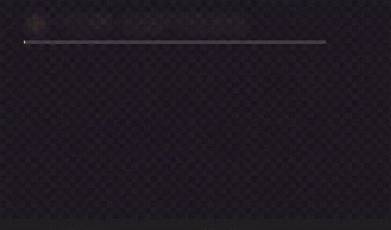
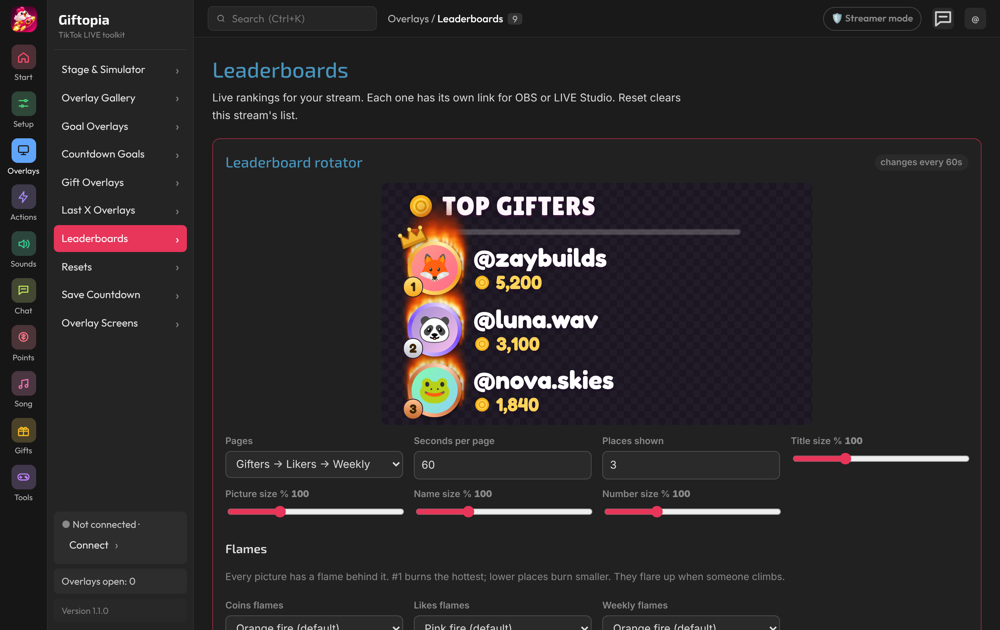
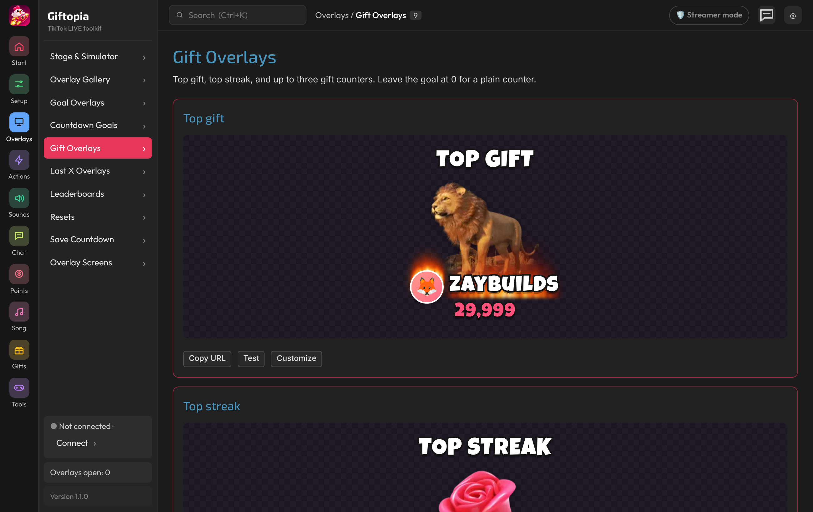
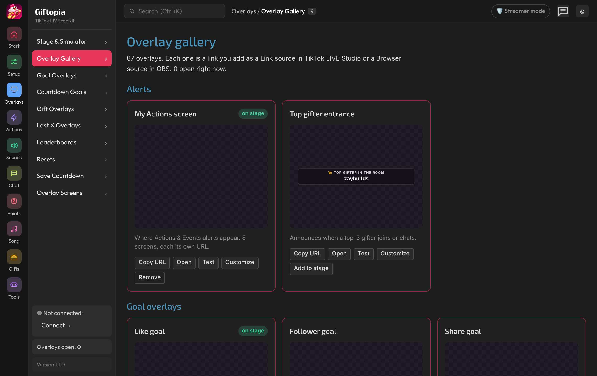
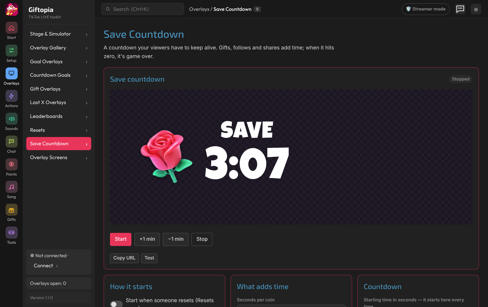

  

<h1 align="center">Giftopia</h1>

  <b>A free desktop app for TikTok LIVE creators.</b> 
  Gift alerts, sound alerts, text-to-speech, fire leaderboards, top gift cards, timers, goals and OBS overlays, all in one place.

  <a href="https://github.com/giftopia-app/giftopia/releases/latest"><b>⬇️ Download Giftopia for Windows</b></a>

  

---

## ✨ What it does

**Leaderboards**
- A moving leaderboard that rotates Top gifters → Top likers → Weekly, with a time-left bar
- Real fire behind the top 3 profile pictures that burns hotter for higher places, plus crowns and rank badges
- Pick the flame colors: orange, pink, any color, random or rainbow
- Top gifters, likers, points, chatters and "most of one gift", up to 8 places each

**Gift overlays**
- Top gift and Top streak cards with profile pictures and floating gifts
- Flames that get bigger for bigger gifts and longer streaks
- Weekly top gift and weekly top streak that stay all week
- A rotator that cycles through all of them

**Alerts and sounds**
- Actions & Events: gift, follow, like, share and chat triggers that play alerts, sounds, keystrokes, OBS scenes, webhooks and more
- Sound alerts with hotkeys, plus a big library of meme sounds
- Text-to-speech for chat, with a content filter

**Timers, goals and games**
- Subathon timer, Save Countdown (viewers keep it alive) and Resets
- Like, follow, share, coin and custom goals, plus countdown goals
- Wheel of Fortune, Penalty Battle, points system, giveaways and polls

**Other**
- 85+ overlays, each with its own link for OBS, Streamlabs or TikTok LIVE Studio
- Every overlay is see-through, with fonts, colors and sizes you can change
- Streamer mode hides your keys and passwords while you're live
- Updates itself when a new version comes out

## 📸 Screenshots

  
  

  
  

## 🚀 Getting started

1. **Download** `Giftopia-Setup.exe` from the [latest release](https://github.com/giftopia-app/giftopia/releases/latest) and run it.
   If Windows shows a blue "Windows protected your PC" box, click **More info → Run anyway**. Giftopia is new and not code-signed yet.
2. **Get your free Euler Stream key.** In Giftopia, go to **Setup** and click **Get my free key**. Sign up (free, no card), create a key, and paste it in. This is what lets Giftopia connect to TikTok LIVE.
3. **Go LIVE on TikTok**, from your phone or LIVE Studio. Type your TikTok @username in Giftopia and click **Connect**.
4. **Add overlays to your stream.** Pick any overlay, click **Copy URL**, then:
   - **OBS / Streamlabs:** add a **Browser** source and paste the link.
   - **TikTok LIVE Studio:** add a **Link** source and paste the link.

Giftopia needs to stay open while you stream.

## ❓ FAQ

**Is it free?** Yes.

**Is my data private?** Your settings and stats stay on your own PC. See the [Privacy Policy](PRIVACY.md).

**How do updates work?** Giftopia checks for new versions by itself. When one is ready, click **Restart now**.

**It stopped connecting.** Giftopia uses an unofficial connection to TikTok LIVE, like other LIVE tools do. If TikTok changes something, it can break until Giftopia is updated. Check for an update, or [report the problem](https://github.com/giftopia-app/giftopia/issues).

**Mac?** Windows only for now.

## 🛟 Help & feedback

Found a bug or have an idea? [Open an issue](https://github.com/giftopia-app/giftopia/issues).

## 📄 Legal

[Terms of Service](TERMS.md) · [Privacy Policy](PRIVACY.md)

Giftopia is an independent app. It is **not** made by, endorsed by, or connected to TikTok or ByteDance. TikTok is a trademark of ByteDance Ltd.
